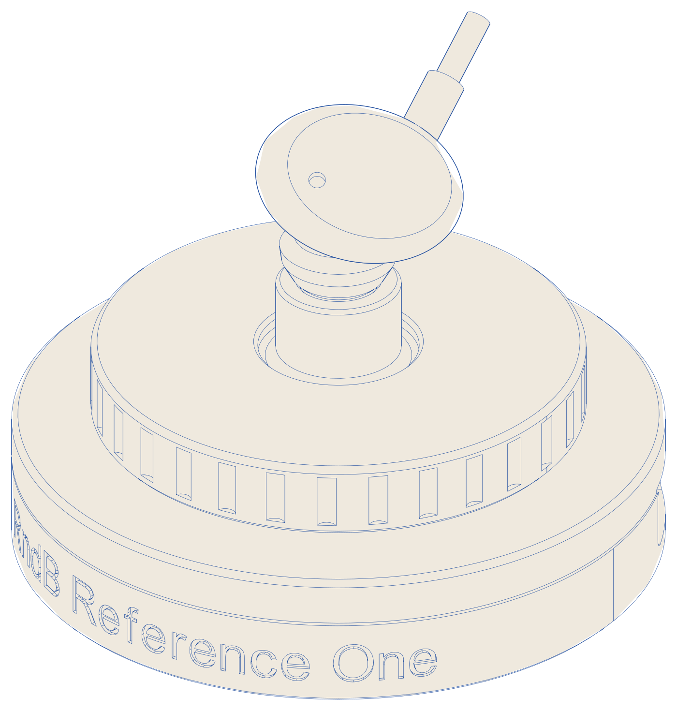
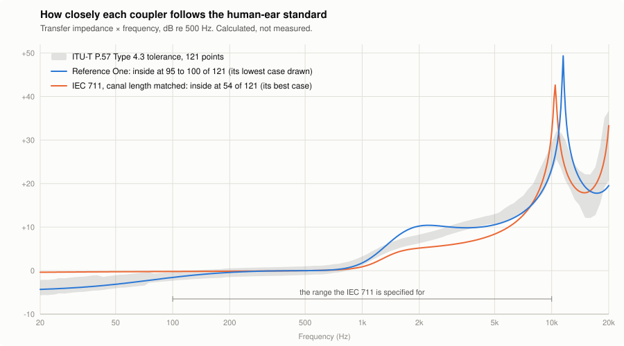
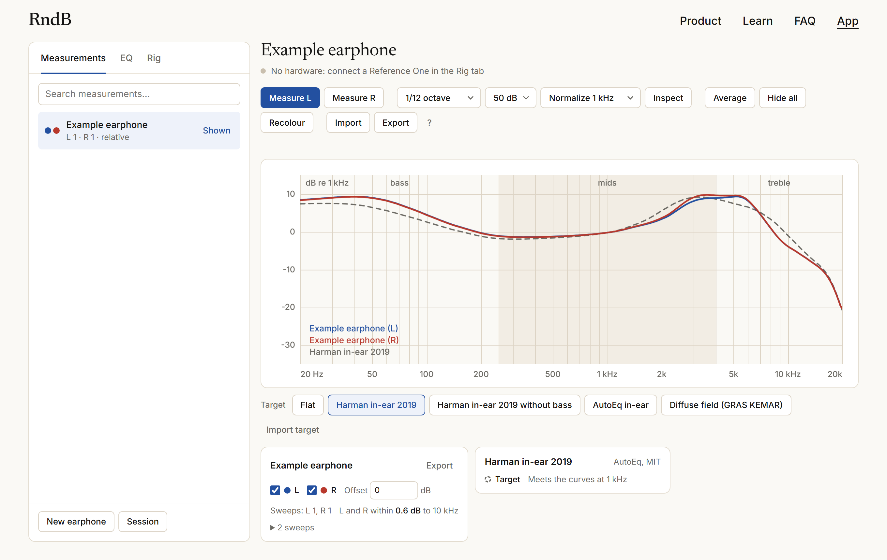
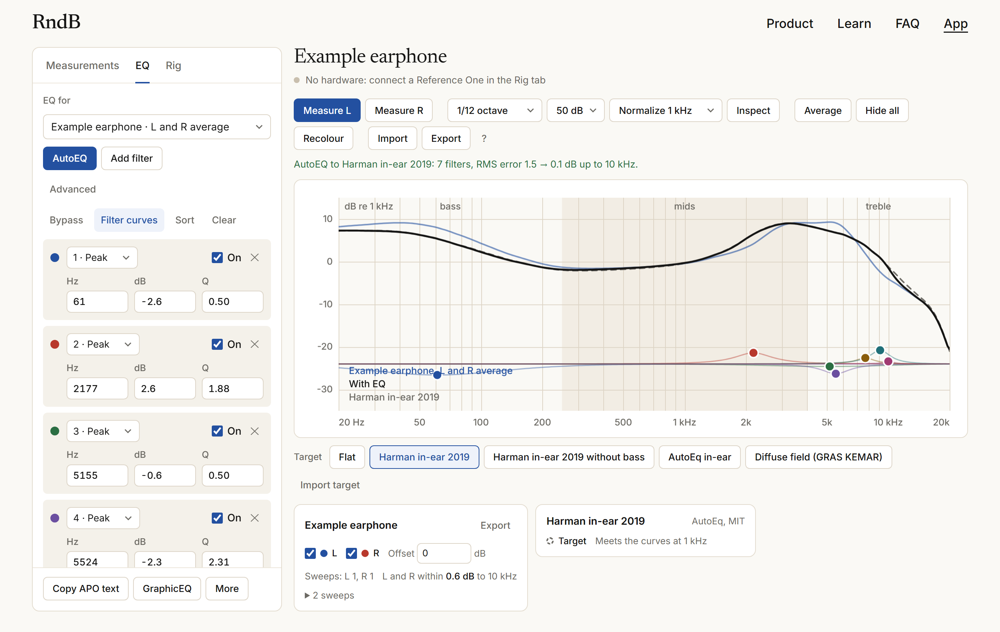

# Reference One

**A USB-C measurement device for in-ear earphones, and the browser app that drives it.**

Plug in a wired earphone, push its tip into the bore on top, and the app draws its frequency
response, distortion and impedance. There is no driver to install and no firmware to update: the
box is a standard USB sound card with a measurement microphone at the end of an ear-simulator
coupler.

<p align="center">
  
</p>

> **Status:** a working prototype. The first boards of the current generation came back from the
> factory in October 2026. It is not for sale yet.

## What it measures

| Measurement | Range |
|---|---|
| Frequency response | 20 Hz to 20 kHz, each side, in dB SPL per volt |
| Impedance | 8 to 300 Ω, as a curve over frequency |
| Distortion | THD near 1 kHz |
| Channel match | The left-right difference, and an EQ that closes it |

## What makes it different

**Its ear simulator is designed against the human-ear standard, not copied from the 711.**

Most earphone measurements are made on an IEC 60318-4 coupler, the "711". That standard covers
100 Hz to 10 kHz, and it says that above 10 kHz the device does not simulate a human ear.
ITU-T P.57 defines a newer ear simulator, Type 4.3: an anatomically shaped ear canal with a
human-like eardrum impedance. It gives the transfer impedance at 121 frequencies from 20 Hz to
20 kHz, with a tolerance at each.

The Reference One's acoustic path was designed against that table. The eardrum's impedance is
reproduced by a network of damping slits and chambers that a resin printer can make, and the
geometry was tuned in a transfer-matrix model until its response followed the standard.

<p align="center">
  <picture>
    <source media="(prefers-color-scheme: dark)" srcset="docs/img/p57-comparison-dark.svg">
    
  </picture>
</p>

| Calculated: points inside the Type 4.3 tolerance | All 121 points | 100 Hz to 10 kHz (81 points) |
|---|---|---|
| Reference One, tip 0 to 3 mm into the bore | 95 to 100 | 59 to 61 |
| IEC 711, as specified | 41 | 37 |
| IEC 711, with its canal length matched to the standard's | 54 | 43 |

How to read this:

- **It is a calculation, not a measurement.** No built unit has yet been checked against a reference ear simulator.
- **The model is checked against the standard itself.** Given the standard's published eardrum impedance, the same model reproduces the standard's table at 107 of 121 points.
- **The 711 was never designed to this table.** It is modelled here from a published micro-CT study of a real coupler (Luan et al., 2019, "A transfer matrix model of the IEC 60318-4 ear simulator"), sealed, with no static vent. It is not specified below 100 Hz or above 10 kHz, so the right-hand column is the fairer comparison.
- **The design is not finished.** The chart shows a rise of about 3 dB around 2 kHz, and a resonance near 10 to 11 kHz that is much sharper than the standard's.

## How it works

1. **Seal.** The earphone's tip seals in a 7.5 mm bore, the same diameter as the 711's, at the entrance of a 3D-printed ear simulator: a canal, damping slits and side chambers.
2. **Sweep.** The app plays a logarithmic sweep through the box's own output stage, at a fixed, quiet level.
3. **Listen.** A measurement microphone at the far end of the coupler records the sweep, and the app turns the recording into the earphone's response.
4. **Impedance.** With the MODE switch flipped, the same sweep reads voltage over current instead, on one ADC clock.
5. **Correct.** The curve is compared with a target, and the difference is exported as EQ.

## The hardware

| Part | Detail |
|---|---|
| Microphone | Infineon IM73A135, an analogue MEMS microphone: 0.03 % distortion at 94 dB SPL, 0.05 % at 110 dB SPL |
| Codec | TI PCM2900C: 16-bit, 48 kHz, USB Audio Class 1, a sound card every computer already knows |
| Output stage | TI OPA1622: 0.0002 % THD+N at 10 mW into 16 Ω, about 0.03 Ω output impedance |
| Output ceiling | 0.104 V in NORMAL, 1.04 V in HIGH |
| Board | Round, Ø58 mm, four layers |
| Body | Ø62 × 29 mm, five resin-printed parts |
| Power | USB bus power, behind an electronic fuse that survives 20 V |
| Controls | Two slide switches: MODE (impedance or measure) and RANGE (NORMAL or HIGH) |
| Firmware | None |

Design decisions:

- **No firmware.** A class-compliant codec carries the audio, so the box runs no code. There is nothing to crash and nothing to update, and it works with any computer that knows a USB sound card.
- **The output ceiling is set in hardware.** Resistor values, not software, set the loudest signal the jack can produce. The HIGH range is for the coupler only and is marked in red on the box.
- **Impedance without a second instrument.** The board reads the earphone's voltage and its current on the two channels of one ADC, so a single sweep gives the impedance curve.
- **A printed ear simulator.** The whole body, coupler included, is five resin-printed parts and about 33 grams of resin. Its acoustic network is simulated and scored against the standard before a part is printed.
- **Generated, not drawn.** The schematic, the board and every enclosure part are generated from Python, with KiCad and CadQuery, so each revision can be rebuilt and checked.

## The app

<p align="center">
  
</p>
<p align="center"><em>The measurement list and the graph, shown with example curves.</em></p>

- **Measurement list.** One entry per earphone, with its left and right sweeps, their average and the left-right difference.
- **One graph.** Overlays with smoothing, normalisation and an inspector, against target curves that include Harman in-ear 2019.
- **Parametric EQ.** Peaking, shelving and pass filters, AutoEQ to the chosen target, and channel matching.
- **Import and export.** Equalizer APO, GraphicEQ, CSV and JSON for EQ; text and CSV for curves.
- **Signal checks.** Before a measurement counts, the core checks that the operating system has not processed the audio, that nothing clipped, that the two channels are distinct, and which way the MODE switch is set.
- **Safety.** With this device the app caps the sweep at −20 dBFS, and plays nothing until the user confirms that no earphone is in an ear.

It runs in the browser on the Web Audio API. There is nothing to install.

<p align="center">
  
</p>
<p align="center"><em>AutoEQ fitting seven filters to a target, on the same example curves.</em></p>

## Built to be checked

- **Tests.** The project has 319 automated tests: 172 for the board and the measurement core, and 147 for the two enclosures. The app's measurement logic runs against a digital twin of the board, so it is tested without hardware.
- **Checks on the CAD.** 245 geometry, acoustics and interference checks run on the solid models before anything is printed. The probes among them carry a control that must fail on a broken part.
- **Regression by bytes.** A change may not alter a part it does not mean to: unchanged parts must come out byte-identical.

What testing caught:

| What looked right | What testing showed | What changed |
|---|---|---|
| Every automated check on a threaded collar passed | The printed collar had no thread: the CAD kernel had silently dropped it | Each part is now probed point by point, and each probe has a control that must fail |
| A keyhole retainer held the earphone in place | Measured with a real earphone, the bass leaked away at 12 to 16 dB per octave | The retainer was redesigned twice, then removed: the tip now seals in the bore itself |
| The first coupler looked sealed | It measured as an open tube, 35 dB short of bass | The coupler was rebuilt around a different seal |

## In this repository

| Path | What it is |
|---|---|
| [`website/app`](website/app) | The measurement app |
| [`hardware/reference_one_v4/app`](hardware/reference_one_v4/app) | The measurement core: pure functions with no DOM and no audio APIs, plus the digital twin |
| [`hardware/reference_one_v4/tests`](hardware/reference_one_v4/tests) | The app's tests |

The rest of the project is not published:

- Gerber and drill files;
- the bill of materials with supplier part numbers;
- pick-and-place data;
- the routed board layout;
- the coupler's internal acoustic design;
- per-unit calibration data.

The board's sources and the enclosure CAD are held back with them. The manufacturing package is
the part that turns a design into "upload and order", so it stays private until the device ships.

## Run it

```bash
# the app, at http://localhost:8777/app/
python -m http.server 8777 --directory website

# the measurement core's tests, then the app's (Python, Node and git; no hardware needed)
node --test hardware/reference_one_v4/app/v4core.test.mjs
python -m pytest hardware/reference_one_v4/tests -q
```

A measurement needs the device. Without one, the app still opens, reads curve files and builds EQ.

## Rights

All rights reserved for now. The source is published so the work can be read, and an open licence
may follow. The target curves in `website/app/data/targets.json` come from
[AutoEq](https://github.com/jaakkopasanen/AutoEq) under the MIT licence, which that file carries.
